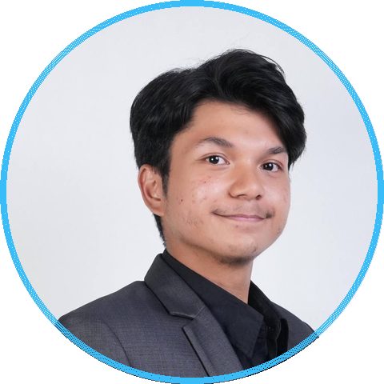

<p align="center">
  
</p>

<table>
  <tr>
    <td width="65%" valign="top">
      <h1>Hi, I'm Daniandra &#128075;</h1>
      <a href="https://github.com/daniandraaa">
        
      </a>
      <p>
        
        <a href="https://github.com/daniandraaa?tab=followers">
          
        </a>
      </p>
      <p>A Technology Entrepreneur & Systems Architect from Indonesia 🇮🇩 bridging <b>full-stack systems engineering (Go, Flutter, IoT, SaaS)</b> with executive strategy across high-growth ventures.</p>
      <p>Currently leading <b>Yudiaz Creative Studio</b>, architecting autonomous multi-agent clusters, researching <b>Hybrid CNN-Transformer models with Explainable AI</b> for cardiac anomaly detection, and serving as CTO at Bandung Techno Park incubated ventures.</p>
      <p>📫 <b>daniandraaa@gmail.com</b> • 🌐 <b><a href="https://daniandraaa.my.id">daniandraaa.my.id</a></b></p>
    </td>
    <td width="35%" valign="middle" align="center">
      
      <br/><br/>
      <a href="https://linkedin.com/in/daniandra"></a>
      <a href="https://daniandraaa.my.id"></a>
      <a href="mailto:daniandraaa@gmail.com"></a>
      <a href="https://x.com/daniandraaa"></a>
    </td>
  </tr>
</table>

## ⚡ About Me

```yaml
name: Daniandra Prayudisty Ilham
location: Bandung, West Java, Indonesia
roles:
  - "Founder & Owner @ Yudiaz Creative Studio"
  - "CTO @ Nexilium (Incubated at Bandung Techno Park - BTP)"
  - "CTO @ Manterra Asset Logistics Management Digitalisation"
  - "Chief Executive Officer (CEO) @ NgeTech Solusi Indonesia"
academics:
  - "Informatics (Computer Science) @ Telkom University"
  - "Recipient of One Pipe Education System (OPES) Full Scholarship by YPT"
  - "Valedictorian (#2 of 392) & Most Outstanding Student @ SMK Telkom Makassar"
currently_working_on:
  - "Research: Premature Ventricular Contraction (PVC) localization with Hybrid CNN-Transformers & XAI"
  - "Orchestrating sovereign autonomous multi-agent clusters (Elara, Raziel, Daffa, Jovan)"
  - "IoT telemetry & real-time SaaS asset tracking infrastructure"
tech_obsessions:
  - "Distributed architectures in Golang"
  - "Autonomous AI agent workflows and production LLM orchestration"
  - "Clean, resilient, high-throughput cloud infrastructure"
fun_fact: "I blend deep-tech systems engineering with executive public speaking & keynote moderation 🎙️"
```

## 🛠️ Tech Stack & Engineering Arsenal

**Languages**
<p>
  
</p>

**Web, Mobile & Frameworks**
<p>
  
</p>

**AI, Deep Learning & Data**
<p>
  
  <br/>
  
  
  
</p>

**Cloud, DevOps & Databases**
<p>
  
</p>

## 🚀 Featured Projects & Ventures

<table>
  <tr>
    <td width="50%" valign="top">
      <h3>🛰️ Yudiaz Sentinel</h3>
      <p>
        <a href="https://github.com/daniandraaa/yudiaz-sentinel">
          
          
        </a>
      </p>
      <p>High-performance, zero-overhead VPS server telemetry and command console. Streams real-time CPU, RAM, disk, network, and process metrics via Server-Sent Events (SSE) with an encrypted, PIN-protected web terminal for multi-server fleet management.</p>
      <p><b>Stack:</b> Golang, Python, Server-Sent Events, Tailwind CSS, Docker</p>
    </td>
    <td width="50%" valign="top">
      <h3>🫀 PVC Localization with CNN-Transformer</h3>
      <p>
        <a href="https://github.com/daniandraaa/PVC-Localization-with-CNN-Transformer">
          
          
        </a>
      </p>
      <p>Deep Learning research merging spatial convolutional feature maps with Transformer multi-head self-attention mechanisms for automated Premature Ventricular Contraction (PVC) cardiac anomaly localization, audited with rigorous Explainable AI (SHAP & Grad-CAM).</p>
      <p><b>Stack:</b> Python, PyTorch, CNN-Transformer, SciPy, SHAP, OpenCV</p>
    </td>
  </tr>
  <tr>
    <td width="50%" valign="top">
      <h3>📦 Manterra Asset Logistics Management</h3>
      <p>
        <a href="https://daniandraaa.my.id">
          
          
        </a>
      </p>
      <p>Centralized enterprise SaaS-based logistics and asset tracking platform. Integrates IoT hardware-software telemetry for real-time fleet movement monitoring, latency reduction, and automated executive decision dashboards.</p>
      <p><b>Stack:</b> Golang, Flutter, MQTT, PostgreSQL, Docker, GCP</p>
    </td>
    <td width="50%" valign="top">
      <h3>🚀 Nexilium MVP</h3>
      <p>
        <a href="https://daniandraaa.my.id">
          
          
        </a>
      </p>
      <p>SaaS platform incubated at Bandung Techno Park (BTP). Formulated the core engineering roadmap from ideation to MVP, deploying modular cloud architecture with integrated applied machine learning capabilities for enterprise clients.</p>
      <p><b>Stack:</b> Python, FastAPI, Next.js, Microservices, Cloud Architecture</p>
    </td>
  </tr>
  <tr>
    <td width="50%" valign="top">
      <h3>🎨 Yudiaz Studio Assets & Design System</h3>
      <p>
        <a href="https://github.com/daniandraaa/yudiaz-assets">
          
        </a>
      </p>
      <p>Official brand identity specifications, master vector brandmarks, typography tokens, dark obsidian theme guidelines, and design system components for Yudiaz Creative Studio ventures.</p>
      <p><b>Stack:</b> SVG, Vector Tokens, Tailwind CSS, Typography Specs</p>
    </td>
    <td width="50%" valign="top">
      <h3>🎬 Eh Tunggu Media Engine</h3>
      <p>
        <a href="https://youtube.com/@ehtunggu">
          
          
        </a>
      </p>
      <p>Autonomous science storytelling and media automation engine: neural voice-over synthesis with ElevenLabs, dynamic vector character motion, and algorithmic YouTube release distribution.</p>
      <p><b>Stack:</b> Python, ElevenLabs API, FFmpeg, YouTube Data API</p>
    </td>
  </tr>
</table>

<p align="center">
  <a href="https://github.com/daniandraaa?tab=repositories">
    
  </a>
</p>

## 📊 GitHub Analytics & Coding Velocity

<div align="center">
  
  
</div>

<div align="center">
  
</div>

<div align="center">
  
</div>

## 🐍 Contribution Snake

<p align="center">
  <picture>
    <source media="(prefers-color-scheme: dark)" srcset="https://raw.githubusercontent.com/daniandraaa/daniandraaa/output/github-contribution-grid-snake-dark.svg" />
    <source media="(prefers-color-scheme: light)" srcset="https://raw.githubusercontent.com/daniandraaa/daniandraaa/output/github-contribution-grid-snake.svg" />
    
  </picture>
</p>

## 🧭 Executive Journey & Milestones

```
2026  ▰▰▰▰▰▰▰▰▰▰▰▰▰▰▰▰▰▰▰▰  Yudiaz Studio, AI Multi-Agents, TEDx Moderator, Nexilium
2025  ▰▰▰▰▰▰▰▰▰▰▰▰▰▰▰▰░░░░  CEO NgeTech, CTO Manterra (SaaS/IoT), CEO CSC Tel-U
2024  ▰▰▰▰▰▰▰▰▰▰▰▰░░░░░░░░  QA Engineering @ PT XL Axiata Tbk, Helphin.id CTO
2023  ▰▰▰▰▰▰▰▰░░░░░░░░░░░░  OPES Full Scholarship Telkom University, Valedictorian
2020  ▰▰▰▰░░░░░░░░░░░░░░░░  Software Engineering @ SMK Telkom Makassar
```

## 🌐 Connect with Me

<p align="center">
  <a href="https://linkedin.com/in/daniandra" target="_blank">
    
  </a>
  <a href="https://daniandraaa.my.id" target="_blank">
    
  </a>
  <a href="mailto:daniandraaa@gmail.com">
    
  </a>
  <a href="https://github.com/daniandraaa" target="_blank">
    
  </a>
  <a href="https://x.com/daniandraaa" target="_blank">
    
  </a>
</p>

<p align="center">
  <i>“Architecture is the thoughtful making of space — both in physical systems and digital intelligence.”</i><br/>
  <b>Daniandra Prayudisty Ilham</b> • Founder &amp; Owner @ Yudiaz Creative Studio
</p>

<p align="center">
  
</p>
