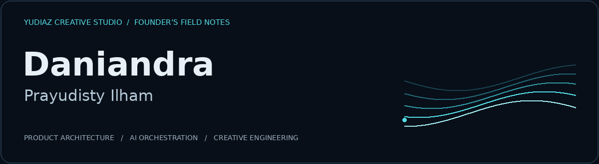

  

# Engineering ideas into useful products.

<table>
<tr>
<td width="72%" valign="top">

I'm **Daniandra Prayudisty Ilham**, CEO & Founder of [Yudiaz Creative Studio](https://yudiaz.my.id). I work across product architecture, full-stack development, and AI-powered automation — connecting creative thinking with the systems that bring it to life.

**Currently focused on** multi-season governance platforms, autonomous agent orchestration, and educational content pipelines.

CEO & Founder at **Yudiaz Creative Studio** · Board Member at **Community Support Center** · Creator of **Eh Tunggu!**

[Website](https://yudiaz.my.id) · [LinkedIn](https://www.linkedin.com/in/daniandra-prayudisty?utm_source=share_via&utm_content=profile&utm_medium=member_ios) · [Email](mailto:daniandraprayudisty@gmail.com) · [YouTube](https://youtube.com/@daniandraprayudisty6466?si=aWU2Inx5wX_-eAoI)

</td>
<td width="28%" align="center" valign="middle">

</td>
</tr>
</table>

## 01 / Selected work

| Project | What I'm building | Stack & links |
| :--- | :--- | :--- |
| **CSC Management Platform** | Community governance with multi-season data isolation, row-level security, role-based access, and financial reporting. | Next.js · TypeScript · Supabase · PostgreSQL [Repository](https://github.com/daniandraaa/csc_management) / [App](https://csc-management.vercel.app) |
| **GitHub Analytics** | Contribution visualization, language breakdowns, and a repository showcase using the GitHub API. | React · TypeScript · Recharts [Repository](https://github.com/daniandraaa/github-analytics) / [Dashboard](https://analytics.daniandraaa.my.id) |
| **Eh Tunggu!** | Science and technology storytelling, supported by AI video, voice synthesis, and publishing automation. | Python · ElevenLabs · Faster-Whisper · YouTube API [Channel](https://youtube.com/@daniandraprayudisty6466?si=aWU2Inx5wX_-eAoI) |
| **Yudiaz AI Agents Collective** | Autonomous agents coordinating operations, infrastructure, research, and document workflows. | Hermes Agent · Claude · Telegram API |

## 02 / Tools of the work

**Languages** — TypeScript, Python, JavaScript, Go, PHP 
**Interface** — React, Next.js, Vite, Tailwind CSS, Three.js 
**Systems & data** — Node.js, Express, PostgreSQL, Supabase, Firebase 
**AI & delivery** — Claude, OpenAI, LangChain, ElevenLabs · Docker, Vercel, Azure, GitHub Actions, Linux

## 03 / GitHub, in context

Data sources, scope & refresh

These are **committed local assets**, not third-party stats embeds. A [daily workflow](.github/workflows/analytics.yml) retrieves GitHub's GraphQL `contributionCalendar` and REST repository/language endpoints, then regenerates the charts. The exact UTC date range and snapshot date are printed on the images; the [source snapshot](assets/github-data.json) is also available.

- Contributions follow **GitHub's definition**, not total commits or hours worked. Visibility follows the generating token; private activity may be omitted or anonymized according to GitHub settings and permissions. Local authenticated runs and Actions can therefore differ.
- Repository and star counts cover **owned public non-fork repositories**, including archived repositories, at generation time. Language shares aggregate GitHub-reported **bytes**, not expertise, effort, or recent usage.
- The scan line is decorative, not a snake simulation or live event feed. SVG animations are progressive enhancement; charts remain readable when a renderer disables animation. The hero is a real, looping GIF.
- A failed API request stops the refresh without replacing the last collected snapshot. See [maintenance notes](MAINTENANCE.md) for reproduction and validation.

## 04 / Let's build something that matters.

I welcome conversations about product architecture, creative technology, community impact, and building with thoughtful teams.

**[daniandraprayudisty@gmail.com](mailto:daniandraprayudisty@gmail.com)** · [Yudiaz Creative Studio](https://yudiaz.my.id)

Clarity first. People matter. Build for impact.
