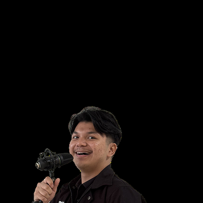

<div align="center">

<!-- ANIMATED HEADER WAVE -->


<!-- PROFILE IDENTITY CARD (PHOTO & CREDENTIALS) -->
<table>
  <tr>
    <td align="center" width="220" style="border: none;">
      <a href="https://daniandraaa.my.id">
        
      </a>
      <br/>
      <b>Daniandra Prayudisty</b><br/>
      <sub>Founder & Owner @ Yudiaz</sub>
    </td>
    <td style="border: none; padding-left: 20px;">
      <!-- TYPING ANIMATION BANNER -->
      <a href="https://daniandraaa.my.id">
        
      </a>
      <br/>
      <p>
        Informatics Scholar at <b>Telkom University</b> (OPES Scholarship) & Founder of <b>Yudiaz Creative Studio</b>. Rekayasa sistem kecerdasan buatan otonom, riset <i>Deep Learning</i> (Hybrid CNN-Transformer & XAI), dan arsitektur cloud berkinerja tinggi.
      </p>
      <!-- SOCIAL & BADGES -->
      <a href="https://daniandraaa.my.id"></a>
      <a href="https://linkedin.com/in/daniandra-prayudisty"></a>
      <a href="https://github.com/daniandraaa"></a>
      <a href="https://x.com/daniandraaa"></a>
    </td>
  </tr>
</table>

</div>

---

### 🏛️ Rekam Jejak Kepemimpinan & Rekayasa Sistem

```ascii
2023 ───► Penerima Beasiswa One Pipe Education System (OPES) Telkom University
2024 ───► QA Engineering Intern @ PT XL Axiata Tbk (IT Core Charging Automation)
2025 ───► Founder & CEO @ Community Support Center (CSC) Telkom University
2025 ───► Co-Founder @ helPhin.id | CEO @ NgeTech Solusi Indonesia
2026 ───► Moderator & Community Relations @ TEDxTelkomUniversity
2026 ───► Founder & Owner @ Yudiaz Creative Studio (Sovereign Autonomous Agent Swarm)
```

---

### 🧠 Riset Deep Learning & Arsitektur Utama

- **Hybrid CNN-Transformer**: Riset arsitektur hibrida yang memadukan ekstraksi fitur spasial konvolusional (CNN) dengan *multi-head attention* Transformer untuk melokalisasi kontraksi ventrikel prematur (PVC) pada data medis.
- **Explainable AI (XAI / SHAP & Grad-CAM)**: Audit interpretasi peta atensi saraf tiruan untuk memverifikasi transparansi penalaran model medis.
- **Sovereign Multi-Agent Cognitive Mesh**: Orkestrasi kluster agen AI terdesentralisasi (Daffa CEO, Raziel CTO, Elara Ops, Jovan Intel, Orca LaTeX) yang berjalan di cloud pribadi dengan observasi telemetri nol-overhead (Yudiaz Sentinel).

---

### 🛠️ Keahlian & Ekosistem Teknologi

<div align="center">

| Kategori | Alat & Bahasa Pemrograman |
| :--- | :--- |
| **Languages** |  |
| **Frameworks & APIs** |  |
| **AI / ML & Data** |  |
| **Cloud & DevOps** |  |

</div>

---

### 🌟 Portofolio Proyek Unggulan

<table>
  <tr>
    <td width="50%">
      <h3 align="center">🛡️ Yudiaz Sentinel</h3>
      <p align="center">Konsol telemetri server VPS real-time berkinerja tinggi berbasis Server-Sent Events (SSE) dengan terminal web berproteksi PIN enkripsi.</p>
      <p align="center">
        <a href="https://github.com/daniandraaa/yudiaz-sentinel">
          
        </a>
      </p>
    </td>
    <td width="50%">
      <h3 align="center">🔬 PVC CNN-Transformer</h3>
      <p align="center">Riset Deep Learning yang menggabungkan CNN dan Transformer untuk lokalisasi anomali jantung secara otomatis dan teruji XAI.</p>
      <p align="center">
        <a href="https://github.com/daniandraaa/PVC-Localization-with-CNN-Transformer">
          
        </a>
      </p>
    </td>
  </tr>
  <tr>
    <td width="50%">
      <h3 align="center">🎨 Yudiaz Studio Assets</h3>
      <p align="center">Spesifikasi identitas jenama resmi, master vektor grafis, token tipografi, dan aset desain Yudiaz Creative Studio.</p>
      <p align="center">
        <a href="https://github.com/daniandraaa/yudiaz-assets">
          
        </a>
      </p>
    </td>
    <td width="50%">
      <h3 align="center">🎬 Engine Media "Eh, Tunggu!"</h3>
      <p align="center">Pipeline otomasi produksi konten sains YouTube: sintesis suara ElevenLabs George, animasi vektor 2D, dan penjadwalan otomatis.</p>
      <p align="center">
        <a href="https://youtube.com/@ehtunggu">
          
        </a>
      </p>
    </td>
  </tr>
</table>

---

### 📊 Statistik, Aktivitas & Performa GitHub

<div align="center">

<table style="border: none;">
  <tr>
    <td align="center" style="border: none;">
      
    </td>
    <td align="center" style="border: none;">
      
    </td>
  </tr>
</table>

<br/>

<!-- STREAK STATS -->


<br/><br/>

<!-- REPO CONTRIBUTION GRAPH / ACTIVITY -->


</div>

---

<div align="center">

<!-- FOOTER ANIMATED WAVE -->


*“Architecture is the thoughtful making of space — both in physical systems and digital intelligence.”*  
**Daniandra Prayudisty Ilham** • Founder & Owner @ Yudiaz Creative Studio 🇮🇩

</div>
